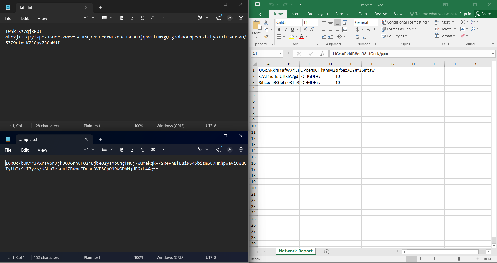
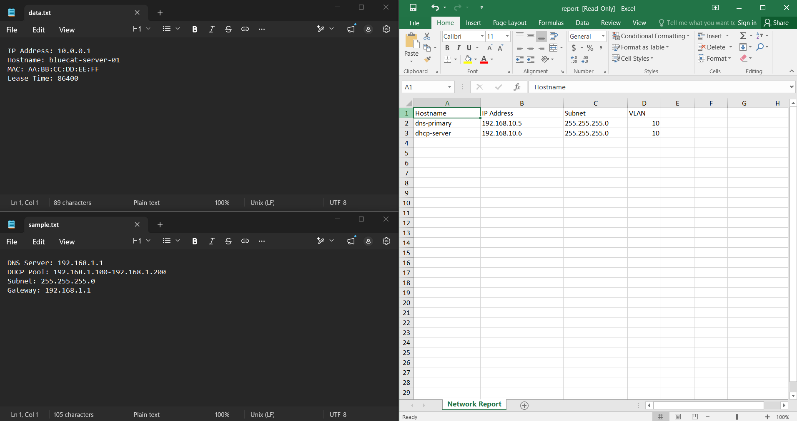

# DDI File Decryption System

## What does this application do?

The system consists of two programs - a client and a server - that together solve one problem: files on disk are encrypted and unreadable, and the goal is for the server to decrypt them and return them in readable form, packed into a ZIP archive.

The whole process looks like this:
1. The client loads the encrypted files from disk
2. The client connects to the server over the network (TCP connection)
3. The client sends the files to the server through that connection
4. The server looks up the matching key for each file in an SQLite database
5. The server decrypts the files with that key
6. The server packs the decrypted files into a ZIP archive and saves it to disk
7. The server sends a message back to the client - success or failure
8. Every action is logged to the database

---

## What exactly is sent over the network?

The client and server communicate through a custom text-based protocol called **DDI/1.0**. No HTTP, WebSocket or framework is used - everything is written by hand using `java.net.Socket` and `java.net.ServerSocket`.

A message from the client to the server looks like this:

```
DDI/1.0 DECRYPT
FILE_COUNT: 2
---
NAME: sample.txt
SIZE: 1024
CONTENT_BASE64
<encrypted file content encoded in Base64>
---
NAME: report.xlsx
SIZE: 4096
CONTENT_BASE64
<encrypted file content encoded in Base64>
END
```

Server response:

```
DDI/1.0 RESPONSE
STATUS: SUCCESS
FILES_PROCESSED: 2
ZIP_PATH: /output/decrypted_20260628_175000.zip
END
```

The encrypted file content is not sent as raw binary data - it is converted to **Base64** (a text representation of binary data) so the whole protocol stays purely text-based and easy to read.

---

## Why is this relevant to DDI?

DDI (DNS, DHCP and IP Address Management) is a domain built entirely around network communication and protocols. The concepts used here map directly to the DDI world:

- **TCP socket programming** is the foundation of DNS-over-TCP, DHCP failover communication between servers, and IPAM API clients
- **Text-based protocol design** follows the same principle as DNS zone transfer messages or DHCP options - every value has a name, and there is a clear end-of-message marker
- **A database for key management** is analogous to an IPAM database that stores IP addresses, lease information and hostname → IP mappings
- **Logging every action** is standard in network infrastructure - every DHCP lease and every DNS query gets logged

---

## Technologies

| What | How |
|---|---|
| Programming language | Java 21 |
| Network communication | `java.net.Socket` and `java.net.ServerSocket` - raw TCP sockets, no framework |
| Protocol | Custom text-based DDI/1.0 protocol, line-delimited, inspired by HTTP structure |
| Encryption | AES-128-CBC (`javax.crypto`) - symmetric encryption with a 16-byte key |
| Binary data transfer | Base64 encoding (`java.util.Base64`) so binary content can pass through a text protocol |
| Database | SQLite via the `sqlite-jdbc` driver - stores keys per file name and action logs |
| xlsx processing | Apache POI - reads the Excel workbook, decrypts every string cell and writes the result back |
| Build | Apache Maven with `maven-shade-plugin` - packs all dependencies into a single fat JAR |
| Tests | JUnit 5 - unit tests and an end-to-end integration test that starts a real server socket |

---

## Requirements

- Two separate applications (client and server) communicating over `java.net.Socket` / `java.net.ServerSocket`
- Text-based protocol only - no serialized Java objects
- The client loads all encrypted files from a given folder; the server decrypts them, zips them and stores the ZIP in a folder given at startup
- Decryption keys are read from an SQLite database
- Every action is logged to the database, and the log table is created automatically if it doesn't exist
- The user is informed about the result (success/failure)
- At least `.txt` and `.xlsx` support, with a design that makes it easy to add new file formats or databases

---

## Running the application

The server is always started first:
```bash
java -jar server_2.jar <port> <path-to-database> <path-to-output-folder>
```

Then the client:
```bash
java -jar client_2.jar <server-address> <port> <path-to-input-folder>
```

## Example run

**Encrypted files - input:**



**Decrypted files - output:**



---

*Author: Bozidar Radosavljevic*